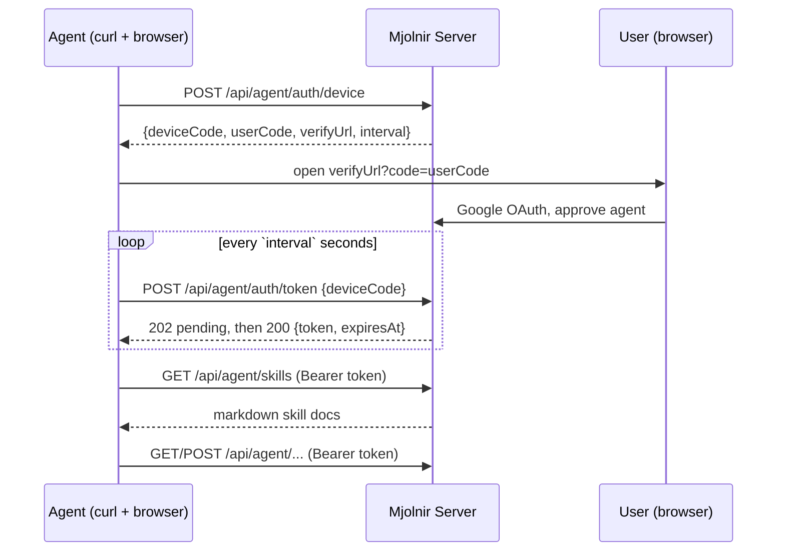

# Spec: Agent Skill Bootstrap (MCP-less access via REST)

**Status**: Draft v1
**Related**: `docs/SPEC-AGENT-INTEGRATION.md` (least-privilege agent model, `/api/agent/*`)

## 1. Problem
Some organizations block external MCP servers for agents such as Copilot, but allow general internet access. The agent can still run `curl` and open a browser. We need an MCP-free path to Mjolnir that needs almost no local setup and picks up new capabilities without local updates.

## 2. Solution Overview
1. **Local bootstrap skill**: one static markdown file given to the agent. It never changes. It teaches only 3 things: `authenticate`, `getSkills`, and how to send the token.
2. **Browser device-code auth**: the agent opens the browser, the user signs in with Google, and the agent receives a short-lived token.
3. **Server-delivered skills**: `GET /api/agent/skills` returns markdown skill docs. The agent reads them and learns what it can do. New capabilities are added server-side only.



## 3. Decisions (from Q&A)
| Topic | Decision |
|---|---|
| Server | New endpoints inside Mjolnir under `/api/agent/*` (no separate service) |
| Auth flow | Device-code style, agent opens browser, polls for token |
| Token | Short-lived agent JWT (default 8h), revocable, tied to user, `isApproved` checked on every request |
| Skill delivery | Markdown docs (endpoints, params, examples) |
| Capabilities (v1) | Same as the existing MCP: least-privilege model in SPEC-AGENT-INTEGRATION (read epics/features/sprints/users/stories, create story, update story status only) |
| Clients | Any agent with shell/curl and a browser, delivered as a plain markdown file |

## 4. Local Bootstrap Skill (`mjolnir-agent-skill.md`)
Static, about 40 lines. Contents:
- `BASE_URL` placeholder, replaced at install time or set by env `MJOLNIR_URL`.
- **Authenticate**:
  1. `POST $BASE/api/agent/auth/device`.
  2. Open `verifyUrl` in the browser and ask the user to approve.
  3. Poll `POST /api/agent/auth/token` every `interval` seconds until 200 or the code expires (10 min).
  4. Keep the token in memory or in a temp file with `chmod 600`. Never print it or commit it.
- **getSkills**: `GET $BASE/api/agent/skills` with `Authorization: Bearer <token>`. Read the result before acting. Re-fetch at the start of each session and on any `409 skills_outdated`.
- **Rules**: send the token on every request. On 401, re-authenticate. On 403, tell the user the account is not approved. Never call endpoints that the skills do not list.

## 5. Server API (new)
| Method | Endpoint | Auth | Purpose |
|---|---|---|---|
| POST | `/api/agent/auth/device` | none (rate limited) | Create device and user code |
| GET | `/agent/auth?code=XXXX-XXXX` (web page) | Google session cookie | User confirms: "Allow agent to act as you?" |
| POST | `/api/agent/auth/token` | none (deviceCode) | Poll. 202 `authorization_pending`, 200 `{token, expiresAt}`, 410 expired/denied |
| POST | `/api/agent/auth/revoke` | Bearer | Revoke the current token |
| GET | `/api/agent/skills` | Bearer | List of skills as markdown (supports `?name=` and `ETag`) |

Existing `/api/agent/*` routes (`us`, `epic`, `feature`, `sprints`, `users`, `me`) stay as they are. `agentAuthMiddleware` also accepts the agent JWT alongside `mj_live_` API keys.

## 6. Token and Security
- JWT claims: `sub` (userId), `typ: "agent"`, `scope`, `jti`, `exp` (8h).
- A `jti` allowlist/denylist in MongoDB (`AgentSession`) enables revocation and a "Connected agents" list in the web UI with a revoke button.
- Middleware verifies the signature, `exp`, not revoked, user exists, and `isApproved === true` on every call.
- Device code: 128-bit random and single use, 10 min TTL. User code is short and human-readable. Rate limit per IP.
- The agent token only gets scopes allowed by the least-privilege policy. It cannot reach non-agent routes (a `typ: agent` token is rejected by the normal `auth` middleware).
- Token is passed only in the `Authorization` header, not in query strings or logs.
- The skills endpoint requires auth, so skill content is not public.

## 7. Skill Content Model
Skills are markdown files stored in the repo (`server/src/skills/*.md`), served by `SkillService`:
```
---
name: stories
version: 3
scopes: [read:tasks, write:tasks]
---
# Stories
GET /api/agent/us ... (params, example curl, errors, rules)
```
- `GET /api/agent/skills` returns an index plus bodies, filtered by the token's scopes.
- `ETag` and `version` let the agent skip re-reading unchanged skills.
- Initial skills: `overview` (workflow rules, WIP limits, status set), `stories`, `planning` (epics, features, sprints, users).

## 8. Implementation Plan
1. `AgentSession` and `DeviceAuth` models and DAL.
2. `AgentAuthService`: device flow, JWT issue/verify, revoke.
3. Routes and controller changes, plus the web confirmation page `/agent/auth` (React, Tailwind) and a "Connected agents" panel.
4. Extend `agentAuthMiddleware` to accept the agent JWT.
5. `SkillService` and the markdown skills.
6. Write `mjolnir-agent-skill.md` (the local bootstrap).
7. Tests: device flow (pending, approve, expire, deny), revoked token, unapproved user, scope filtering, skills ETag.

## 9. Resolved Decisions
1. **Token lifetime**: fixed 8h, re-authenticate afterwards. No refresh token.
2. **Base URL**: read from the env var `MJOLNIR_URL` (no hardcoded URL in the skill).
3. **No browser available**: the agent prints `verifyUrl` and `userCode` and the user opens them manually.
4. **Skill safety (pending confirmation, default = yes)**: the bootstrap only allows HTTP calls to `$MJOLNIR_URL`. Server skills are treated as API documentation only, so they cannot make the agent run local commands or contact other hosts.
5. **Scope**: v1 is Mjolnir-only. No extra tools or plugin system.

## 10. Web UI: "Can't use MCP?" button
On the MCP setup page in the web app, add a **"Can't use MCP?"** button. It opens a panel that:
- Explains in 3 steps: download the skill file, set `MJOLNIR_URL`, tell the agent to use the skill.
- Offers a **Download `mjolnir-agent-skill.md`** button (served by the server, with the correct base URL pre-filled in the example).
- Lists "Connected agents" (created, last used, revoke).

## 11. Local caching (added)
- Token cached in `~/.mjolnir/agent.json` (chmod 600, keyed by `MJOLNIR_URL`). Reused until `expiresAt` or a `401`.
- Skills cached in `~/.mjolnir/skills.json` with their ETag. Each session sends one `GET /api/agent/skills` with `If-None-Match`: `304` = token valid and skills current, `200` = refresh cache, `401` = re-authenticate.
- Server unchanged; only the bootstrap template changed.

## 12. One-step install (added)
- The bootstrap file is a real skill (`name: mjolnir` + `description` front matter), so agents load it automatically in new sessions.
- The server URL is baked in (`MJOLNIR_URL` env var is an optional override).
- The "Can't use MCP?" panel has per-agent install commands (personal skills dirs: `~/.copilot/skills/mjolnir/`, `~/.gemini/skills/mjolnir/`, `~/.claude/skills/mjolnir/`) plus a copy-paste prompt so the agent installs itself.
